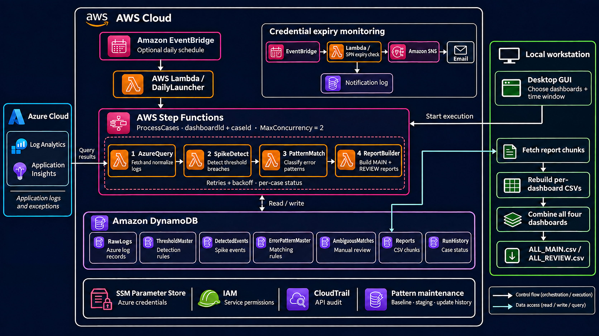
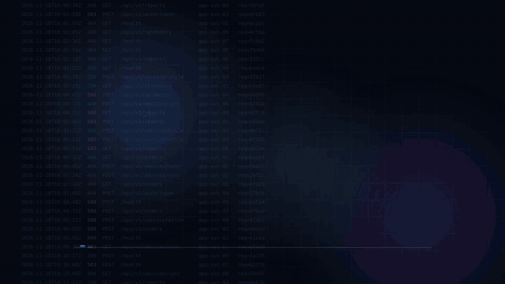
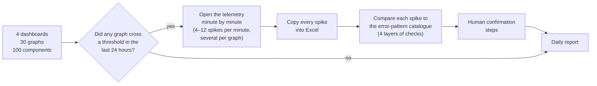
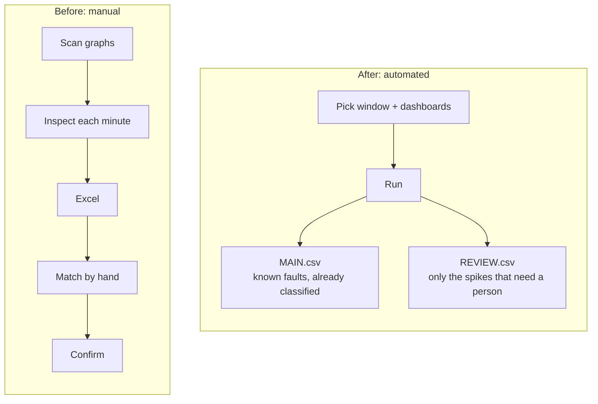
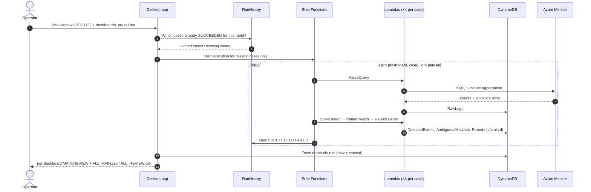

# Vehicle Fault Alert Automation System

Every morning, two engineers spent 3–4 hours each going through error spikes on four monitoring dashboards. They checked them minute by minute, copied them into Excel and matched each one by hand against a catalogue of known faults. This system does that work in a single run, and leaves people only the spikes a machine can't classify with confidence.

30-second walkthrough: the operator app, the pipeline, spike classification and safe pattern updates. Silent preview; click for the full video with sound.

> **About this repository.** The system was built for a production environment, so the source code and configuration are not public. This repo documents the design: the problem, the architecture, every component, the data model and the engineering decisions behind them. Internal names have been generalized. The four dashboards are called **Alpha, Beta, Gamma and Delta**, and application names, IDs and accounts are left out.

---

## Contents

- [The problem](#the-problem)
- [What the system does](#what-the-system-does)
- [Architecture](#architecture)
- [How a run works](#how-a-run-works)
- [Engineering highlights](#engineering-highlights)
- [Component documentation](#component-documentation)
- [Scope and status](#scope-and-status)

---

## The problem

More than 100,000 vehicles send telemetry and equipment reports to a fleet of cloud services. One department uses that data to predict which vehicle parts are about to fail and to restock them before customers need them. That only works if the services handling the data stay healthy. An operations-room team watched them through four Azure monitoring dashboards.

Each dashboard is a set of **graphs and info tables, in pairs**. Dashboard Gamma alone has 19 graphs. Each graph tracks several service components, and every component has its own error limits: one for client errors (4xx) and one for server errors (5xx). A graph with three components carries three sets of limits.

The daily check looked like this:

- **Effort:** two people, 3–4 hours each, about 7 person-hours every day.
- **Real challenge:** the procedure lived in a spreadsheet and in the operators' experience. Turning every one of those judgement calls into rules precise enough to trust was harder than the plumbing.

## What the system does

For any time window, the system:

1. **pulls** per-minute 4xx/5xx counts for every component from Azure Log Analytics and Application Insights, aggregated by KQL inside Azure;
2. **detects** every minute where a component met or crossed its threshold, and merges back-to-back breach minutes into a single event;
3. **classifies** each event against the error-pattern catalogue with the same four-layer check operators used: URL path, component, HTTP method, then status code;
4. **reports** two CSVs, **MAIN** (matched, known faults) and **REVIEW** (ambiguous or unknown spikes that need a person), per dashboard and combined across all four.

The operator picks a time window and dashboards in a desktop app and presses **Run**. If part of that window was already processed, the finished cases are reused instead of re-run.

## Architecture

| Layer | Components | Role |
|---|---|---|
| **Source** | Azure Log Analytics, Application Insights | Application request and exception logs. KQL aggregates them to 1-minute buckets *inside Azure*, so only counts and evidence cross the cloud boundary. |
| **Orchestration** | AWS Step Functions | One execution per run. A Map state fans out over every *(dashboard, case)* pair with `MaxConcurrency = 2`. Each task has retries and backoff, and status is recorded per case. |
| **Processing** | 4 Lambda functions | `AzureQuery` → `SpikeDetect` → `PatternMatch` → `ReportBuilder`, one clear job per stage. |
| **State** | 11 DynamoDB tables | Raw rows, detected events, reports, run history, thresholds and the pattern catalogue. Working data expires after 7 days through TTL; the catalogue and audit tables are kept. |
| **Operator side** | Desktop app (Python) | Starts runs, reuses finished cases, rebuilds per-dashboard CSVs and the combined ALL4 output, and updates the pattern catalogue from Excel. |
| **Support** | SSM Parameter Store, IAM, CloudTrail, SNS | Azure credentials kept only in SSM, scoped service roles, audit trail, and email alerts before the Azure credential expires. |
| **Optional** | EventBridge + `DailyLauncher` Lambda | Daily scheduled runs. Built and deployable, switched off by default. |

Full breakdown: **[docs/architecture.md](docs/architecture.md)**

## How a run works

1. **Run identity.** The run ID comes from the selected window, so asking for the same window again lands on the same ID, and finished cases are served from `RunHistory`.
2. **Fan-out.** Step Functions runs each *(dashboard, case)* pair through the four stages. If a case still fails after retries, it is marked `FAILED` with its error details and the execution stops. Cases that already finished stay `SUCCEEDED`, so the next run only redoes what's missing.
3. **Ingest.** `AzureQuery` gets a cached Azure AD token, queries up to 4 workspaces in parallel, retries on throttling (429) and 5xx at 1 s, 2 s and 4 s, and batch-writes normalized rows.
4. **Detect.** `SpikeDetect` sums counts per *(component, status class, minute)*, compares them with `ThresholdMaster` and writes one event per breach window, plus the top 3 evidence rows from its first minute.
5. **Classify.** `PatternMatch` labels each event `MATCHED`, `AMBIGUOUS`, `UNMATCHED` or `FILTERED`.
6. **Report.** `ReportBuilder` writes the MAIN and REVIEW CSVs into DynamoDB in 200 KB chunks. The desktop app rebuilds them locally.

Step-by-step detail: **[docs/lambda-functions.md](docs/lambda-functions.md)** · Algorithms: **[docs/detection-and-matching.md](docs/detection-and-matching.md)**

## Engineering highlights

- **Compute where the data lives.** Thresholds are defined on KQL results, so aggregation happens in Azure. Bringing raw request logs across clouds would be slower and cost more, and nothing downstream needs them.
- **Unit of work = one graph.** The state machine maps over *(dashboard, case)* pairs, not whole dashboards, and records status for each. A failure costs the graphs that hadn't finished, not the whole day's run.
- **Deterministic and idempotent.** Event IDs are a hash of *run, dashboard, case, component, class and minute*. Candidate sorting is fixed, and re-running PatternMatch and ReportBuilder on the same run produces identical output. A dedicated validation script checks that last property.
- **A matcher that knows when to stop.** Ties are never broken arbitrarily. If the four layers leave more than one candidate, the spike goes to REVIEW with the candidate pattern numbers attached.
- **Safe catalogue updates.** Operators maintain the error patterns in Excel. Every update snapshots the live table, wipes and reloads only the affected dashboard's rows, logs the file's SHA-256 and the operator, and restores the snapshot automatically if anything fails.
- **No secrets on disk.** Azure service-principal credentials live in SSM as a `SecureString` and are read at runtime. A separate scheduled Lambda emails the team 30, 15 and 0 days before the credential expires, with a conditional write so each reminder goes out once.

## Component documentation

| Document | What's inside |
|---|---|
| [Architecture](docs/architecture.md) | Components, state machine, failure paths and design decisions |
| [Lambda functions](docs/lambda-functions.md) | Each Lambda's job, inputs, outputs, tables, limits and failure modes |
| [Data model](docs/data-model.md) | All 11 DynamoDB tables: key design, attributes, TTL and access patterns |
| [Detection and matching](docs/detection-and-matching.md) | Spike detection algorithm and the four-layer pattern matcher, with worked examples |
| [Operator app](docs/operator-app.md) | Run flow, run cache, guard rails and the Excel pattern-update flow with rollback |
| [Operations and security](docs/operations-and-security.md) | Deployment, credentials, monitoring, testing approach and production lessons |

## Scope and status

**v0.5, in use.** Day-to-day runs are started manually from the desktop app.

| Area | Status |
|---|---|
| 4-stage pipeline for all four dashboards (30 graphs, 100 components) | Working |
| Desktop app: runs, run cache, ALL4 combined output | Working |
| Excel → pattern catalogue update with snapshot and restore | Working |
| Credential-expiry email alerts | Working |
| EventBridge daily schedules | Built, off by default |
| Post-update audit scripts | 3 of 4 dashboards |
| AMBIGUOUS spikes | Sent to REVIEW for a person, not auto-resolved |

## Tech stack

Python 3.12 · AWS SAM (CloudFormation) · AWS Step Functions · AWS Lambda · Amazon DynamoDB · Amazon EventBridge Scheduler · Amazon SNS · AWS Systems Manager Parameter Store · AWS IAM · AWS CloudTrail · Azure Monitor (Log Analytics, Application Insights, KQL) · Azure AD client-credentials auth · Tkinter

---

**Ankit Singh** · [LinkedIn](https://www.linkedin.com/in/ankit-singh-108827200/)
