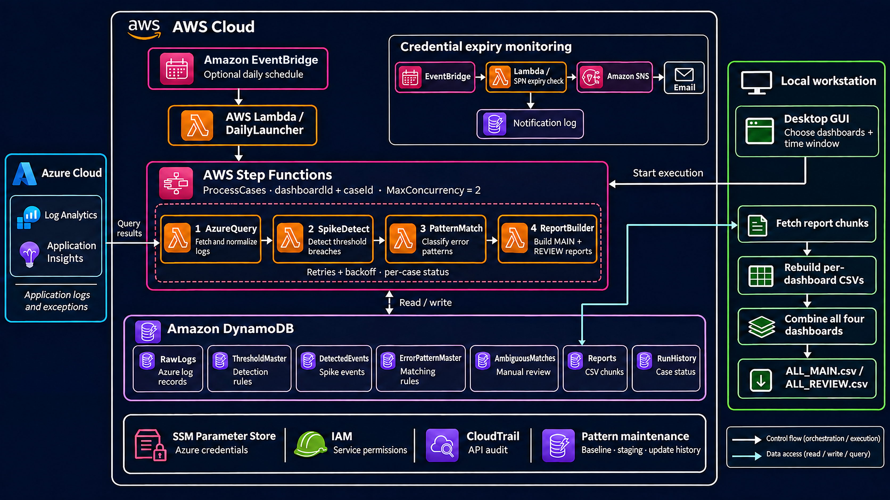
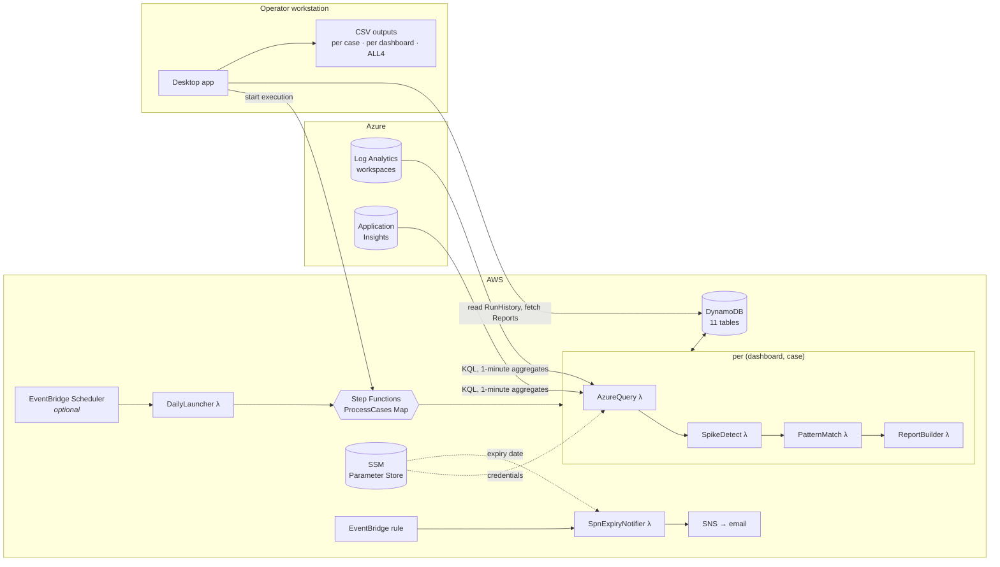
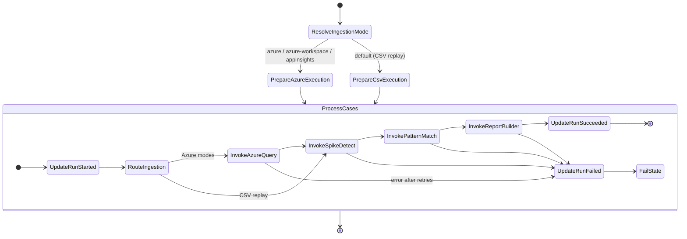
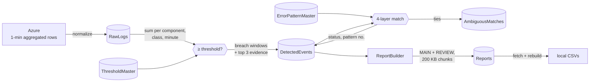

# Architecture

[← Back to README](../README.md)

The system spans three places: **Azure**, where the application logs live; **AWS**, where detection, matching and reporting run; and the **operator's workstation**, where runs start and reports end up.



## Components at a glance



| Component | Type | Responsibility |
|---|---|---|
| Desktop app | Python / Tkinter, runs locally | Starts runs, checks the run cache, rebuilds CSVs, updates the pattern catalogue. See [operator-app.md](operator-app.md). |
| `Pipeline` state machine | Step Functions, Standard | Splits a run into cases and drives the four Lambdas per case with retries and status tracking. |
| `AzureQuery` | Lambda | Authenticates to Azure, runs KQL, normalizes rows into `RawLogs`. |
| `SpikeDetect` | Lambda | Turns per-minute counts into threshold-breach events. |
| `PatternMatch` | Lambda | Classifies each event against the error-pattern catalogue. |
| `ReportBuilder` | Lambda | Serializes MAIN and REVIEW CSVs into chunked `Reports` items. |
| `DailyLauncher` | Lambda | Optional scheduled entry point: computes the previous day's window and starts an execution. |
| `SpnExpiryNotifier` | Lambda | Daily check of the Azure credential's expiry date; emails at 30, 15 and 0 days. |
| DynamoDB | 11 tables, on-demand billing | All run state, masters and audit trails. See [data-model.md](data-model.md). |
| SSM Parameter Store | `String` / `SecureString` | Azure tenant ID, client ID and client secret; credential expiry date and email recipients. |

Per-Lambda detail: [lambda-functions.md](lambda-functions.md)

## The unit of work: a case

A **dashboard** is a collection of **graphs**. In the code each graph is a **case**: a `(dashboardId, caseId)` pair with its own components, data sources and thresholds. The state machine never processes "a dashboard" as one unit. It maps over the flat list of cases.

| Dashboard | Graphs (cases) | Components | Log source | Event mode | Matcher |
|---|---:|---:|---|---|---|
| Alpha | 2 | 5 | Log Analytics (App Insights mode available) | Consecutive minutes merged | URL → component → method → status code |
| Beta | 4 | 8 | Log Analytics (App Insights mode available) | One event per minute | URL → component → method → status code |
| Gamma | 19 | 82 | Log Analytics | Consecutive minutes merged | Same four layers, tried on each of the top 3 evidence rows |
| Delta | 5 | 5 | Log Analytics, trace-derived (error code, exception type, message) | One event per minute | Message snippet → component → exception type, plus a known-noise filter |
| **Total** | **30** | **100** | | | |

Each component has two thresholds, one for 4xx and one for 5xx, stored per `dashboard × case × component × class` in `ThresholdMaster`.

The per-dashboard differences are kept small and explicit: a named constant and an `if` at the point where the behaviour diverges. Beta and Delta report every breach minute as its own event; Alpha and Gamma merge consecutive minutes. Delta's logs are trace-derived records rather than HTTP requests, so its matcher compares message text instead of URLs.

## State machine



**Execution input**

| Field | Meaning |
|---|---|
| `runId` | Run identity. The desktop app derives it from the window end time, so repeating the same window gives the same ID. |
| `cases[]` | `{dashboardId, caseId}` items. Only the cases that still need work. |
| `ingestionMode` | `azure-workspace` (default), `appinsights`, `azure`, or anything else for CSV replay. |
| `startTimeUtc`, `endTimeUtc` | Query window. The app converts JST input to UTC. |
| `ttlEpochSec` | Expiry stamped on every runtime item the run creates. |
| `diagMode`, `diagnostics`, `workspaceIds` | Switches for the diagnostic probe path in `AzureQuery`. |

**Run status.** `UpdateRunStarted`, `UpdateRunSucceeded` and `UpdateRunFailed` are direct DynamoDB `updateItem` integrations with no Lambda involved. They write `status`, `startedAt`, `finishedAt` and `errorDetails` to `RunHistory` under `RUN#{runId}#DASH#{dashboardId}#CASE#{caseId}`.

**Retries.** Every Lambda task retries on `Lambda.ServiceException`, `Lambda.AWSLambdaException`, `Lambda.SdkClientException` and `States.TaskFailed`: 3 attempts, 2 s first interval, backoff ×2. Anything still failing is caught (`States.ALL`), recorded as `FAILED` with the error payload, and ends the execution in `FailState`. Cases that finished earlier keep their `SUCCEEDED` status, so the next run skips them.

**Concurrency.** `MaxConcurrency = 2` on the Map. Each `AzureQuery` invocation can open up to 4 parallel workspace queries, so a run never has more than 8 Azure queries in flight.

**CSV replay mode.** When `ingestionMode` is not an Azure mode, `RouteIngestion` skips `AzureQuery` and starts at `SpikeDetect`. A local script loads exported CSVs into `RawLogs` beforehand. This is how detection and matching were developed and backtested against known days without touching Azure.

## Data flow through one case



## Local output layout

```text
out/
├── <Dashboard>/individual/   per-case MAIN and REVIEW CSVs
├── <Dashboard>/final/        per-dashboard merged MAIN and REVIEW
└── ALL4Dashboards_<YYYYMMDD_HHMM>_<runId>/
    ├── ALL_MAIN.csv          all four dashboards, fixed order
    └── ALL_REVIEW.csv
```

The combined files concatenate the dashboard finals in a fixed order. A missing dashboard is skipped; a header-only file contributes only the header.

## Design decisions

**1. Aggregate in Azure, not in AWS.**
The thresholds were defined against KQL results, so KQL is the reference. `AzureQuery` asks Azure for 1-minute buckets (`summarize … by bin(timestamp, 1m)`) of 4xx and 5xx requests, with 401s excluded. Pulling raw request logs across clouds would cost more and run slower, and nothing downstream needs them. Only counts and the evidence fields used for matching cross the boundary.

**2. One partition per case, shared across tables.**
`RawLogs`, `DetectedEvents`, `AmbiguousMatches`, `Reports` and `RunHistory` all use the partition key `RUN#{runId}#DASH#{dashboardId}#CASE#{caseId}`. Every stage reads its input with a single-partition `Query`, never a table scan, and every artifact of a run expires on the same TTL.

**3. Reports live in DynamoDB as chunks.**
CSV bytes are split into 200 KB pieces, safely under DynamoDB's 400 KB item limit, and stored as a `META` item plus numbered `CHUNK` items. All run state stays in one service and under one partition key, and expires together.

**4. Each Lambda owns one stage, and only its tables.**
SpikeDetect never reads the pattern catalogue; matching happens only in PatternMatch. This boundary was enforced after an incident. A change had let SpikeDetect query the catalogue, the deployed IAM role correctly refused it, and the fix was to restore the boundary rather than widen the permission. See [operations-and-security.md](operations-and-security.md#lessons-learned).

**5. Deterministic everywhere.**
Event IDs are `sha1(run|dashboard|case|component|class|startMinute)`, evidence rows and pattern candidates are sorted with explicit tie-breakers, and run IDs come from the window. Re-running a stage overwrites items with identical content instead of creating duplicates. That is what makes the run cache and partial re-runs safe.

**6. Manual first, scheduled optional.**
The EventBridge schedules and `DailyLauncher` are deployed behind CloudFormation conditions and switched off by default. Day-to-day runs are started by an operator from the desktop app, who picks the reporting window. Turning on a schedule is a deploy-parameter change, not a code change.

**7. Replace, don't diff, the pattern catalogue.**
When operators edit the Excel catalogue, rows get renamed, renumbered and reordered. A scoped wipe and reload of one dashboard's rows removes stale entries that a row-by-row diff would miss. The risk of a full replace is covered by a staging snapshot and automatic restore. See [operator-app.md](operator-app.md#updating-the-error-pattern-catalogue).
