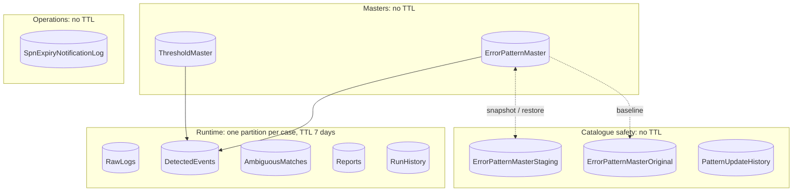

# Data model

[← Back to README](../README.md)

Eleven DynamoDB tables, all on-demand (`PAY_PER_REQUEST`), all with composite keys. They fall into four groups:



## Key design

Every runtime table shares one partition key format:

```text
PK = RUN#{runId}#DASH#{dashboardId}#CASE#{caseId}
```

This gives each case's data one home across five tables:

- every pipeline stage reads its input with a single `Query` on one partition, with no scans on the hot path;
- a case can be inspected end to end by querying the same key in each table;
- all of a run's working data expires together through `ttlEpochSec`.

Sort keys are built so the natural read order is also the useful order. Events sort by start minute, and report chunks sort by chunk number.

## Tables

### RawLogs: normalized Azure rows

| | |
|---|---|
| **PK** | `RUN#{runId}#DASH#{dashboardId}#CASE#{caseId}` |
| **SK** | `TS#{timestampUtc}#APP#{appName}#RC#{resultCode}#H#{shortHash}` |
| **Attributes** | `runId`, `dashboardId`, `caseId`, `csvRowNo`, `timestampUtc`, `minuteUtc`, `resultCode`, `codeClass`, `name`, `url`, `requestUrl`, `exceptionType`, `message`, `performanceBucket`, `appName`, `roleName`, `item`, `ttlEpochSec` |
| **Written by** | AzureQuery, or the CSV ingest tool in replay mode |
| **Read by** | SpikeDetect; ReportBuilder (fallback) |
| **TTL** | 7 days |

`item` is the number of requests the aggregated row represents. Detection sums `item`; it doesn't count rows. The short hash in the SK keeps two rows with the same timestamp, component and code distinct.

### ThresholdMaster: detection limits

| | |
|---|---|
| **PK** | `DASH#{dashboardId}#CASE#{caseId}#APP#{appName}` |
| **SK** | `CLASS#{4xx\|5xx}` |
| **Attributes** | `dashboardId`, `caseId`, `appName`, `codeClass`, `threshold`, `updatedAt` |
| **Written by** | Seed script, from the versioned case configuration |
| **Read by** | SpikeDetect (all rows for one case, by PK prefix) |
| **TTL** | none |

200 rows in total: 100 components × 2 classes.

### DetectedEvents: breach windows and their classification

| | |
|---|---|
| **PK** | `RUN#{runId}#DASH#{dashboardId}#CASE#{caseId}` |
| **SK** | `EVT#{startMinuteUtc}#APP#{appName}#CLASS#{codeClass}#ID#{eventId}` |
| **Set by SpikeDetect** | `eventId`, `appName`, `codeClass`, `startMinuteUtc`, `runLenMinutes`, `thresholdUsed`, `minuteCountStart`, `top3[]`, `evidencePolicy`, `createdAt` |
| **Added by PatternMatch** | `patternStatus`, `patternDisposition`, `patternNo`, `patternName`, `matchUrlPrefixUsed`, `allMatchedPatterns[]`, `reportMatches[]`, `reviewEvidenceRows[]` |
| **Read by** | PatternMatch, ReportBuilder, the local rebuild step |
| **TTL** | 7 days |

`eventId = sha1(runId|dashboardId|caseId|appName|codeClass|startMinuteUtc)[:24]`, so re-running detection is idempotent. `evidencePolicy` records which evidence-selection rule produced `top3`.

### ErrorPatternMaster: the fault catalogue

| | |
|---|---|
| **PK** | `DASH#{dashboardId}#CLASS#{codeClass}` |
| **SK** | `URL#{urlPrefix}#APP#{resourceName}#M#{methodOrStar}#P#{patternNo}` |
| **Attributes** | `envName`, `codeClass`, `resourceName`, `methodOrStar`, `urlPrefix`, `patternNo`, `patternName`, `patternDisposition`, `nameRaw`, `urlRawList`, `errorCodesRaw`, `enabled`, `updatedAt` |
| **Written by** | The desktop app's Excel update flow |
| **Read by** | PatternMatch |
| **TTL** | none |

The SK starts with the URL prefix on purpose. The matcher's first layer is `Query PK = DASH#…#CLASS#… AND begins_with(SK, "URL#{prefix}")`, run once per prefix from most specific to least. The remaining layers filter that small candidate set in memory. `patternDisposition` is either *existing* (a known, tracked fault) or *exclude* (known and intentionally ignored). `errorCodesRaw` keeps the workbook's original status-code cell; the matcher pulls explicit 4xx/5xx codes out of it.

For Delta, `urlPrefix` holds a message snippet and `methodOrStar` holds an exception type, because Delta's evidence is trace-derived. The key shape stays the same, so one table and one update flow serve all four dashboards.

### AmbiguousMatches: ties waiting for a person

| | |
|---|---|
| **PK** | `RUN#{runId}#DASH#{dashboardId}#CASE#{caseId}` |
| **SK** | `EVT#{eventId}#TS#{startMinuteUtc}` |
| **Attributes** | `eventId`, `appName`, `codeClass`, `startMinuteUtc`, `evidenceUrl`, `candidatePatterns[]` (number and disposition), `reason`, `ambiguityRows[]`, `updatedAt` |
| **Written by** | PatternMatch, only when candidates are still tied after every layer |
| **TTL** | 7 days |

PatternMatch deletes the item again if a later re-run resolves the event, so the table only ever holds live ambiguities.

### Reports: chunked CSVs

| | |
|---|---|
| **PK** | `RUN#{runId}#DASH#{dashboardId}#CASE#{caseId}` |
| **SK** | `REP#CSV#MAIN#META`, `REP#CSV#MAIN#CHUNK#000001`, … and the same for `REVIEW` |
| **META attributes** | `reportKey`, `reportName`, `totalChunks`, `totalBytes`, `generatedAt` |
| **CHUNK attributes** | `reportKey`, `chunkDataB64` |
| **Written by** | ReportBuilder |
| **Read by** | The desktop app's fetch step |
| **TTL** | 7 days |

The reader queries the partition, finds `META`, then walks chunks `1…totalChunks` in order. A missing chunk is a hard error, never a silently truncated CSV. The decoded bytes are written as-is, with no text re-encoding.

### RunHistory: per-case status and the run cache

| | |
|---|---|
| **PK** | `RUN#{runId}#DASH#{dashboardId}#CASE#{caseId}` |
| **SK** | `META` |
| **Attributes** | `status` (`STARTED` / `SUCCEEDED` / `FAILED`), `startedAt`, `finishedAt`, `errorDetails`, `dashboardId`, `caseId`, `ttlEpochSec` |
| **Written by** | Step Functions directly (DynamoDB service integration, no Lambda) |
| **Read by** | The desktop app, to skip cases that already `SUCCEEDED` |
| **TTL** | 7 days |

### ErrorPatternMasterStaging: rollback snapshot

Same key shape as `ErrorPatternMaster`. Cleared and refilled with an exact copy of the live catalogue at the start of every update, and used to restore it if the update fails.

### ErrorPatternMasterOriginal: immutable baseline

Same key shape. A one-time copy of the catalogue as first migrated, kept as a recovery point that no update ever touches.

### PatternUpdateHistory: catalogue audit trail

| | |
|---|---|
| **PK** | `UpdateRunId` |
| **SK** | `META` |
| **Attributes** | `startedAtUtc`, `finishedAtUtc`, `operatorWindowsUser`, `selectedExcelFilename`, `selectedExcelSha256`, `dashboardCounts` (parsed, loaded, skipped per dashboard), step flags with timestamps (`SNAPSHOT_OK`, `WIPE_OK`, `RELOAD_OK`, `RESTORE_OK`), `stagingClearedCount`, `stagingSnapshotCount`, `finalStatus`, `errorMessage` |
| **finalStatus values** | `STARTED` → `SUCCEEDED` · `FAILED` · `FAILED_RESTORED` · `FAILED_RESTORE_FAILED` |

Each update answers three questions: who changed the catalogue, with exactly which file (by hash), and how far the update got.

### SpnExpiryNotificationLog: one row per reminder sent

| | |
|---|---|
| **PK** | `SPN#{credentialName}` |
| **SK** | `DATE#{yyyy-mm-dd}#D{daysRemaining}` |
| **Attributes** | `SpnName`, `DaysRemaining`, `ExpiryUtc`, `Recipients`, `CreatedAtUtc` |
| **TTL** | none |

Written with a conditional put **before** the email is published. The key itself is the deduplication guard.

## Access patterns

| # | Access pattern | Table | Operation |
|---|---|---|---|
| 1 | All raw rows for a case | RawLogs | `Query PK` |
| 2 | Thresholds for a case | ThresholdMaster | `Scan` filtered by PK prefix (≤ 200 items) |
| 3 | All events for a case, in time order | DetectedEvents | `Query PK, begins_with(SK, "EVT#")` |
| 4 | Pattern candidates for one URL prefix | ErrorPatternMaster | `Query PK, begins_with(SK, "URL#{prefix}")` |
| 5 | All Delta patterns for a class | ErrorPatternMaster | `Query PK` |
| 6 | A report's META and chunks | Reports | `Query PK`, then reassemble by chunk number |
| 7 | Did this case already succeed? | RunHistory | `GetItem PK, SK=META` |
| 8 | Update or restore the catalogue for one dashboard | ErrorPatternMaster, Staging | `Scan` keys by PK prefix, `BatchWriteItem` |
| 9 | Was today's reminder already sent? | SpnExpiryNotificationLog | conditional `PutItem` |

## Who touches what

| Component | RawLogs | Threshold | Events | Patterns | Ambiguous | Reports | RunHistory | Staging / Original / History |
|---|:-:|:-:|:-:|:-:|:-:|:-:|:-:|:-:|
| AzureQuery | W | | | | | | | |
| SpikeDetect | R | R | W | | | | | |
| PatternMatch | | | R/W | R | W/D | | | |
| ReportBuilder | R* | | R | | | W | | |
| Step Functions | | | | | | | W | |
| Desktop app: run | | | R | | | R | R | |
| Desktop app: pattern update | | | | R/W | | | | R/W |

R = read · W = write · D = delete · \* fallback only

## Retention

| Data | Kept for | Why |
|---|---|---|
| Raw rows, events, ambiguities, reports, run status | 7 days (TTL) | Working data. The durable output is the CSV the operator keeps. |
| Thresholds and pattern catalogue | Indefinitely | Configuration |
| Staging snapshot | Until the next update | Rollback point |
| Original baseline | Indefinitely | Last-resort recovery |
| Update history and reminder log | Indefinitely | Audit |

DynamoDB deletes expired items in the background, usually within days of expiry rather than to the second. Nothing in the system relies on exact deletion timing.
