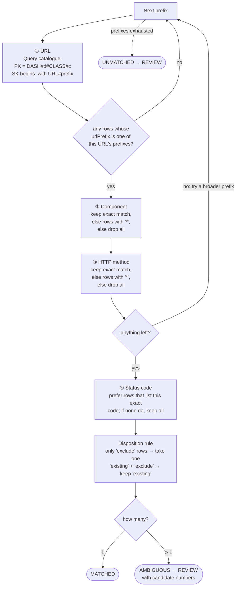

# Detection and matching

[← Back to README](../README.md)

These two algorithms replace what the operators did by eye and by spreadsheet. The rule for both: **be exactly as strict as the human process, and when that isn't enough to decide, say so.**

All URLs, component names and numbers below are made-up examples.

---

## Spike detection

### Definition

A **breach minute** is a minute in which a component's summed request count for one status class reached its threshold:

```text
breach(component, class, minute)  ⇔  Σ item  ≥  threshold(dashboard, case, component, class)
```

- `item` is the request count the aggregated row represents, not the number of rows.
- Thresholds are per component and per class (4xx and 5xx separately), looked up from `ThresholdMaster`. If a component has no row, a per-class default applies.
- The comparison is `≥`: reaching the threshold counts as a breach.

### From breach minutes to events

Example: component `app-svc-02`, class `5xx`, threshold **5**.

| Minute (UTC) | 18:20 | 18:21 | 18:22 | 18:23 | 18:24 | 18:25 |
|---|---:|---:|---:|---:|---:|---:|
| Σ item | 3 | **7** | **12** | **6** | 2 | **9** |
| Breach? | – | ✔ | ✔ | ✔ | – | ✔ |

How these become events depends on the dashboard:

| Mode | Used by | Result |
|---|---|---|
| **Merged** | Alpha, Gamma | `18:21 ×3 min`, `18:25 ×1 min` → **2 events** |
| **Merged, evidence changed** | Alpha, Gamma | If the dominant failing request at 18:23 differs from 18:21–18:22: `18:21 ×2`, `18:23 ×1`, `18:25 ×1` → **3 events** |
| **Per minute** | Beta, Delta | `18:21`, `18:22`, `18:23`, `18:25` → **4 events** |

**Why split on an evidence change?** Each event is matched using the evidence from its *first* minute. If a window kept growing while the failing endpoint changed underneath it, the later failure would be hidden behind the earlier one's classification. Splitting when the primary evidence row changes means every distinct failure gets its own classification.

### Evidence

For each event, the **top 3 rows of its first minute** are stored with it:

1. sorted by `item` descending (the largest contributor is the *primary* evidence),
2. then by source row number, timestamp and key, so ties always resolve the same way.

Each evidence row carries timestamp, status code, operation name (which starts with the HTTP method), URL, latency bucket, component and count. These are the same fields an operator copied into Excel.

Each event also records `runLenMinutes`, `thresholdUsed`, `minuteCountStart` and an `evidencePolicy` tag, so a REVIEW row can be checked against the dashboard without re-querying Azure.

---

## Pattern matching

The error-pattern catalogue is a spreadsheet maintained by operators. Each row says, roughly: *"a 5xx on this URL path, from this component, with this HTTP method (and optionally these status codes) is known fault #N"*, with a disposition of **existing** (a tracked fault) or **exclude** (known and deliberately ignored).

Matching an event means finding **exactly one** catalogue row that fits its primary evidence.

### Step 0: normalize the URL

| Rule | Example |
|---|---|
| Cut everything after the first `=` (keep the `=`) | `…/sync?token=8f2c…` → `…/sync?token=` |
| Remove the masking token `***` | `…/users/***/profile` → `…/users//profile` |

Query-string values never block a match; parameter names still count.

### Step 1: generate candidate prefixes, specific to broad

For the evidence URL `https://api.example.com/v1/devices/sync?token=`:

```text
1  https://api.example.com/v1/devices/sync?token=   ← full URL with query
2  https://api.example.com/*                        ← host wildcard row
3  https://api.example.com/v1/devices/sync
4  https://api.example.com/v1/devices/sync/
5  https://api.example.com/v1/devices
6  https://api.example.com/v1/devices/
7  https://api.example.com/v1
8  https://api.example.com/v1/
9  https://api.example.com
```

Each path is tried with and without a trailing slash, so a catalogue row written either way still matches. The host-wildcard row comes second, straight after the exact URL.

### Step 2: the four layers

The matcher walks the prefixes in order. At each prefix:



**Layer ① (URL)** is a DynamoDB query, because the catalogue's sort key starts with the URL prefix. Layers ②–④ filter a handful of candidates in memory.

**Layers ② and ③ are strict on purpose.** If the evidence has a concrete component or method and no row at this prefix supports it, the candidate set is dropped and the matcher moves to a broader prefix. Treating "wrong method" as a tie would send spikes to REVIEW that a broader catalogue row matches cleanly.

**Layer ④ is a preference, not a filter.** Many catalogue rows don't list status codes. Listing one makes a row *more* specific; leaving it out doesn't disqualify the row.

**The disposition rule.** When both tracked-fault and exclusion rows survive, the tracked fault wins. When only exclusion rows survive, one is chosen deterministically and the event is `MATCHED` as an exclusion. It is a final answer and doesn't leak into REVIEW.

### Worked example

Evidence: component `app-svc-02`, operation `POST /v1/devices/sync`, status **503**.

Catalogue rows in `DASH#Alpha#CLASS#5xx`:

| Pattern | urlPrefix | component | method | codes | disposition |
|---|---|---|---|---|---|
| #031 | `https://api.example.com/v1/devices` | `*` | POST | 500, 503 | existing |
| #032 | `https://api.example.com/v1/devices` | `*` | POST | 502 | existing |
| #040 | `https://api.example.com/v1` | `app-svc-02` | `*` | – | existing |

| Prefix tried | ① URL | ② component | ③ method | ④ code 503 | Result |
|---|---|---|---|---|---|
| 1–4 | none | | | | next |
| 5 `…/v1/devices` | #031, #032 | `*` rows → #031, #032 | POST → #031, #032 | #031 lists 503 → **#031** | **MATCHED #031** |

With status **504**, layer ④ finds no row listing 504 and keeps both. Two "existing" rows remain, so the result is **AMBIGUOUS**. The spike goes to REVIEW with `candidatePatternNos = 031|032` and reason `tie_after_url_class_method_app`. Pattern #040 is never reached: the matcher stops at the most specific prefix that produced candidates, and doesn't widen just to break a tie.

### Dashboard-specific behaviour

| Dashboard | Difference | Notes |
|---|---|---|
| **Gamma** | Tries the top 3 evidence rows in order and takes the first clean match. If none match, an ambiguous result is reported ahead of an unmatched one. | Gamma covers 82 components across 19 graphs. A miss on the largest contributor doesn't end the search. |
| **Delta** | Matches on **message text** instead of URL. Whitespace is removed from both sides; an exact match scores 1,000,000 + length, containment scores the length of the shorter text, and the best score wins. Component and exception type are then preferred, but not required. | Delta's evidence is trace-derived, and its catalogue identifies faults by message text and exception type. |
| **Delta** | Evidence matching a fixed list of known-noise messages is marked **FILTERED** and left out of both reports. | A small, fixed rule list in code, kept separate from the catalogue. |

### What the operator receives

| Status | Report | Meaning |
|---|---|---|
| `MATCHED`, disposition *existing* | MAIN | Known fault. Pattern number, name and the URL prefix used are included. |
| `MATCHED`, disposition *exclude* | MAIN | Known and deliberately ignored, with the disposition shown. |
| `AMBIGUOUS` | REVIEW | The catalogue can't separate the candidates. All candidate numbers are listed. |
| `UNMATCHED` | REVIEW | Not in the catalogue. A possible new fault. |
| `FILTERED` | none | Known noise (Delta only). |

The REVIEW file is the queue for human judgement. Each row has the evidence that was tried, the candidates found and the reason code, so the operator starts from the machine's analysis instead of the raw graph.

### Guarantees

- **Deterministic.** Candidates are sorted by pattern number, disposition, component, method and prefix before any decision. The same input always gives the same output. A validation script re-runs PatternMatch and ReportBuilder on a finished run and checks that nothing changed.
- **No silent tie-breaking.** More than one surviving candidate is never resolved by picking the first one.
- **Same rules, every run.** The matching procedure that was carried out by hand is now one versioned function.
