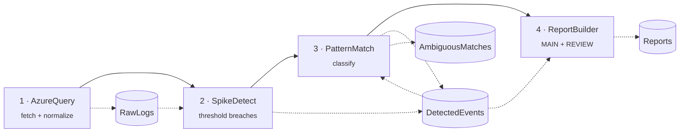
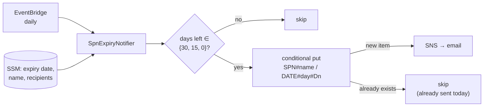

# Lambda functions

[← Back to README](../README.md)

Six functions, all Python 3.12, deployed with AWS SAM. Four make up the pipeline and run once per case, in order. Two run independently.

| Function | Trigger | Timeout | Memory | Reads | Writes |
|---|---|---:|---:|---|---|
| [AzureQuery](#1-azurequery) | Step Functions | 300 s | 512 MB | SSM, case config, Azure APIs | `RawLogs` |
| [SpikeDetect](#2-spikedetect) | Step Functions | 240 s | 256 MB | `RawLogs`, `ThresholdMaster` | `DetectedEvents` |
| [PatternMatch](#3-patternmatch) | Step Functions | 240 s | 256 MB | `DetectedEvents`, `ErrorPatternMaster` | `DetectedEvents`, `AmbiguousMatches` |
| [ReportBuilder](#4-reportbuilder) | Step Functions | 240 s | 256 MB | `DetectedEvents`, `RawLogs` (fallback) | `Reports` |
| [DailyLauncher](#5-dailylauncher) | EventBridge Scheduler (optional) | 180 s | 256 MB | case config | starts Step Functions |
| [SpnExpiryNotifier](#6-spnexpirynotifier) | EventBridge rule, daily | 60 s | 256 MB | SSM | `SpnExpiryNotificationLog`, SNS |

Each pipeline Lambda takes `{runId, dashboardId, caseId}` and works on exactly one partition, `RUN#{runId}#DASH#{dashboardId}#CASE#{caseId}`. None of them pass bulk data through Step Functions. The state machine only carries identifiers and small summaries, and data moves through DynamoDB.

---

## 1. AzureQuery

**Job:** get the case's 4xx/5xx activity for the window out of Azure, as 1-minute aggregates, and store it in a uniform shape.

**Steps**

1. Load the case's configuration: components, Log Analytics workspaces or Application Insights apps, and an `allowed` flag per workspace.
2. Read the service-principal credentials from SSM and get an Azure AD token with the client-credentials flow. Tokens are cached per scope inside the warm Lambda and refreshed 60 s before expiry.
3. Run a cheap **preflight** query (`summarize rows=count(), components=dcount(...)`) to confirm the target has data for the exact component filter.
4. Run the main KQL against each allowed workspace, **up to 4 in parallel** (thread pool). The query filters to the window, keeps only 4xx and 5xx results except 401, filters to the case's components, and does `summarize item = sum(itemCount) by bin(timestamp, 1m), resultCode, name, url, performanceBucket, appName, roleName`.
5. Normalize every row: `timestampUtc`, `minuteUtc`, `appName`, `roleName`, `url`, `requestUrl`, `resultCode`, `codeClass` (`4xx`/`5xx`), `exceptionType`, `message`, `item` (the request count the row represents).
6. Write to `RawLogs` with `BatchWriteItem` in groups of 25, each item stamped with a 7-day TTL.

**Resilience**

- HTTP timeout 30 s. Retries at 1 s, 2 s and 4 s on 429, 5xx and network timeouts.
- A workspace that fails is recorded in `workspaceFailures` and the others continue. The invocation only fails if **every** workspace failed for a reason other than 403. A 403 means "not authorized for this workspace", which is a configuration fact, not an outage.
- A **diagnostic mode** runs targeted probe queries (row counts by component and by role name, and resource-ID filters) to debug empty results without changing the main path.

**Dashboard specifics**

- Workspace schemas differ, so the source table is resolved per workspace (`AppRequests` or `requests`; `AppTraces` or `traces` for Delta).
- Delta's rows come from trace records with their own error codes. Non-HTTP numeric codes are classed as `5xx` so they aren't silently checked against a zero threshold.

**Returns:** rows prepared and written, the source table used per workspace, preflight results, and success and failure counts.

**Failure modes:** invalid or expired credentials, missing workspace configuration for the case, Azure API outage, `RawLogs` write failure.

---

## 2. SpikeDetect

**Job:** decide which minutes broke a threshold, and turn them into events.

**Steps**

1. `Query` the case partition in `RawLogs`, with pagination.
2. Load thresholds for the case: all `ThresholdMaster` items under `DASH#{d}#CASE#{c}#APP#…`, giving a map of *(component, class) → limit*. If a component has no row, a default per class is used.
3. Sum `item` per *(component, class, minute)*.
4. For each *(component, class)*, keep the minutes where `count ≥ threshold`.
5. Build event windows. Alpha and Gamma merge consecutive minutes, splitting when the minute's main evidence row changes; Beta and Delta use one event per minute. See [detection-and-matching.md](detection-and-matching.md#spike-detection).
6. For each window, take the **top 3 evidence rows** from its first minute: highest `item` first, then a deterministic tie-break.
7. Write one `DetectedEvents` item per window with `eventId = sha1(run|dashboard|case|component|class|startMinute)[:24]`, `runLenMinutes`, `thresholdUsed`, `minuteCountStart`, `top3`, and a 7-day TTL.

**Why the hash ID matters:** re-running SpikeDetect on the same data overwrites the same items instead of creating duplicates.

**Returns:** raw rows read and events created.

**Failure modes:** malformed threshold rows, malformed raw rows, `DetectedEvents` write failure.

---

## 3. PatternMatch

**Job:** label every event as a known fault, an excluded known fault, an ambiguous match or an unknown, without ever guessing.

**Steps**

1. Read the case's events (`SK begins_with EVT#`).
2. For each event, take its primary evidence row (`top3[0]`). Gamma tries all three evidence rows in order and stops at the first clean match.
3. Run the four-layer matcher (URL prefix → component → method → status code), then the disposition rule. Full walkthrough with examples: [detection-and-matching.md](detection-and-matching.md#pattern-matching).
4. Update the event in place:
   - `MATCHED`: `patternNo`, `patternName`, `patternDisposition`, `matchUrlPrefixUsed`, and the alert rows for the report.
   - `AMBIGUOUS`: more than one candidate survived every layer. The candidates go into `reviewEvidenceRows` and an `AmbiguousMatches` item.
   - `UNMATCHED`: no candidate at any URL depth.
   - `FILTERED`: Delta only. Evidence matching a fixed list of known-noise messages is dropped from both reports.
5. Remove a stale `AmbiguousMatches` item if a re-run now resolves the event.

**Returns:** counts of processed, matched, excluded, unmatched, ambiguous and filtered events. These are useful as a per-case health line in the logs.

**Failure modes:** malformed catalogue rows, `DetectedEvents` update failure, `AmbiguousMatches` write or delete failure.

---

## 4. ReportBuilder

**Job:** produce the two CSVs operators actually read.

| Report | Contains | Key columns |
|---|---|---|
| **MAIN** | Matched events | run, dashboard, component, class, start minute (JST and UTC), minute count, run length, threshold, pattern status, disposition, number and name, URL prefix used, and Alert 1–3 evidence (timestamp, code, name, URL, latency bucket, component, count) |
| **REVIEW** | Ambiguous and unmatched events | the same event context, plus the evidence row tried, `candidatePatternNos`, `candidateDispositions`, `reason`, and Alert 1–3 |

**Steps**

1. Read all events for the case.
2. Build MAIN rows from matched events and REVIEW rows from unresolved evidence. Re-read `RawLogs` only when `minuteCountStart` has to be recalculated.
3. Serialize to CSV bytes, then split into **200 KB chunks**.
4. Write a `META` item (`totalChunks`, `totalBytes`, `generatedAt`) and `CHUNK#000001…` items with base64 payloads, all with a 7-day TTL.

**Failure modes:** malformed events, serialization or chunking failure, `Reports` write failure.

---

## 5. DailyLauncher

**Job:** the scheduled entry point. Off by default.

- Three EventBridge Scheduler schedules exist, each behind its own CloudFormation condition: two single-dashboard daily runs and one all-dashboards run.
- Computes the previous reporting window in JST and converts it to UTC.
- Expands the configured cases and starts **one** Step Functions execution in Azure ingestion mode.
- Supports a `dryRun` flag that logs the computed run without starting it.

---

## 6. SpnExpiryNotifier

**Job:** make sure the Azure credential never expires unnoticed. It runs separately from the reporting pipeline.

- Reads the expiry date, credential name and recipients from SSM. Missing parameters fail fast.
- Days remaining are counted in JST calendar days.
- Notifies only on days 30, 15 and 0.
- Writes the log item with `attribute_not_exists(PK) AND attribute_not_exists(SK)` **before** publishing. A duplicate trigger on the same day hits `ConditionalCheckFailedException` and sends nothing.
