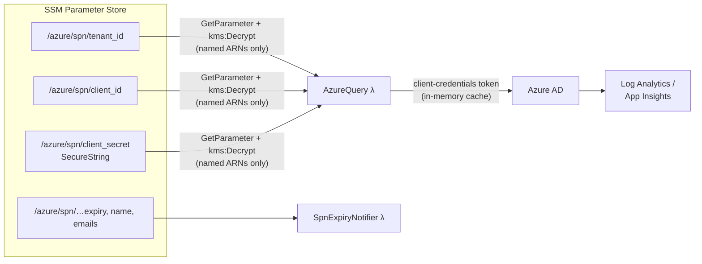

# Operations and security

[← Back to README](../README.md)

## Infrastructure as code

Everything in AWS is defined in a single AWS SAM template and deployed as one CloudFormation stack:

| Resource | Count |
|---|---|
| Lambda functions | 6 |
| Step Functions state machine (Standard) | 1 |
| DynamoDB tables (on-demand) | 11 |
| SNS topic (credential-expiry email) | 1 |
| EventBridge schedules and rules | 4, each behind its own condition |
| IAM roles | one per function from its own policy, plus scheduler roles |

Optional features are **parameters**, not branches of code:

| Parameter | Default | Creates |
|---|---|---|
| `Enable<Dashboard>Schedule` (×2) | `false` | Daily single-dashboard runs for two of the dashboards |
| `EnableAllDashboardsDailySchedule` | `false` | Daily all-dashboards run |
| `EnableSpnExpiryNotifySchedule` | `false` | Daily credential-expiry check |

**Configuration as code.** Each case's components, log sources and thresholds live in one versioned configuration file. `ThresholdMaster` is seeded from it by script, so a threshold change is reviewed like code. The error-pattern catalogue is the exception: it belongs to the operators and changes through the [Excel update flow](operator-app.md#updating-the-error-pattern-catalogue).

**Deployment steps**

```text
sam validate → sam build → sam deploy
→ create SSM parameters (Azure tenant ID, client ID, client secret as SecureString)
→ seed ThresholdMaster from config
→ load ErrorPatternMaster from the workbook
→ run the desktop app
```

## Security



- **No credentials on disk.** The Azure service-principal secret exists only in SSM as a `SecureString`. `AzureQuery` reads it at runtime and keeps the resulting token in memory only. The desktop app never sees Azure credentials; it uses the operator's AWS profile.
- **Least privilege per function.** Each Lambda's role names the exact tables and actions it needs. For example, `AzureQuery` can only `BatchWriteItem` and `PutItem` on `RawLogs`, `SpnExpiryNotifier` can only `PutItem` on its log table and publish to its topic, and SSM access is limited to the specific parameter ARNs. The full access matrix is in [data-model.md](data-model.md#who-touches-what).
- **Read-only towards Azure.** The pipeline only issues log queries against Azure; it never writes there.
- **Auditable.** AWS API activity is visible in CloudTrail. Catalogue changes are recorded in `PatternUpdateHistory` with the operator's user name and the workbook's SHA-256.
- **Credential lifecycle.** The secret has an expiry date. `SpnExpiryNotifier` emails the team 30, 15 and 0 days ahead, exactly once per milestone (see [lambda-functions.md](lambda-functions.md#6-spnexpirynotifier)).

## Observability

| Where | What you see |
|---|---|
| `RunHistory` | Per-case status, start and finish times, and the full error payload for failed cases |
| Step Functions execution history | Which state failed, with input and output for every step |
| Lambda logs | One summary line per invocation in `key=value` form, e.g. `eventsProcessed=… matched=… excluded=… unmatched=… ambiguous=…` |
| `AzureQuery` responses | Per-workspace failures with HTTP status, source table used, preflight row counts |
| Desktop app log | Every step, cache hit or miss, the exact commands it ran, and the files it wrote |

`AzureQuery` also has a **diagnostic mode** that runs targeted probe queries (row counts by component and role, and resource-ID filters) to explain an empty result without changing the production query path.

## Testing approach

| Technique | What it proves |
|---|---|
| **CSV replay** | Exported Azure query results for real days, organized per dashboard and per graph, are loaded into `RawLogs`. The state machine skips `AzureQuery` and runs detection, matching and reporting against them. This made detection and matching repeatable on fixed inputs while they were being built. |
| **Backtest runner** | Starts the pipeline on a replayed run and rebuilds MAIN and REVIEW locally for side-by-side comparison. |
| **Idempotency check** | Re-invokes PatternMatch and ReportBuilder on a finished run and asserts that `DetectedEvents` and `Reports` are unchanged. |
| **Threshold verification** | Asserts that every configured case has its threshold rows in `ThresholdMaster`. |
| **Catalogue audits** | Compare workbook-expected rows with the live catalogue: missing rows, extra rows, over-broad prefixes. |
| **Packaging checks** | `py_compile` on key files, `sam validate`, and a scan for forbidden artifacts before a distribution zip is produced. |

## Lessons learned

Two incidents shaped how the system is built and changed.

### 1. Code, package and deployment drifted apart

**Symptom.** The desktop app worked on one PC and failed on another. Output folder structure changed unexpectedly, and one dashboard's output became abnormal.

**Cause.** Local source, shared ZIP packages and the deployed stack weren't always from the same commit. Different people ran `sam build` and `sam deploy` from different versions.

**Fix.**
- Pin one known-good baseline commit and branch from it for new work.
- Deploy only the functions a change touches.
- After deploying, verify each target Lambda's `LastModified`, handler and runtime.
- Build distribution packages with a script: no `.git`, no build artifacts, no runtime CSVs, then `py_compile` and `sam validate` before zipping.

### 2. An IAM error that was really a code error

**Symptom.** A run failed at `InvokeSpikeDetect` with `AccessDeniedException: SpikeDetectLambda is not authorized to perform dynamodb:Query on ErrorPatternMaster`.

**Cause.** A change had added a pattern-catalogue lookup inside SpikeDetect. The deployed role correctly didn't allow it, because SpikeDetect isn't supposed to read the catalogue.

**Fix.** Instead of granting the permission, the stable SpikeDetect logic was restored, the stray query path was removed, only that function was redeployed, and a minimal Step Functions run confirmed `SUCCEEDED`.

**Takeaway.** An access-denied error can mean the policy is missing *or* the code is doing something it shouldn't. Check which before widening a role.

## Change discipline

Changes, including AI-assisted ones, followed one written template:

1. **Pin** the branch and the known-good commit that must be preserved.
2. **Declare no-touch areas.** A GUI-only change, for example, may not modify Lambda logic, the state machine, DynamoDB data or deployment commands.
3. **Investigate read-only first.** Inspect code and read-only AWS APIs, then report before changing anything.
4. **Make the smallest change**, validate it, and report evidence: changed files, exact commands, validation output, AWS resource state, `git status` and the commit hash.
5. **Two phases for high-risk work.** Confirmation only, then changes after approval.

Standing rules: stop and report when uncertain; don't add fallback logic that hides failures; don't change unrelated files.
