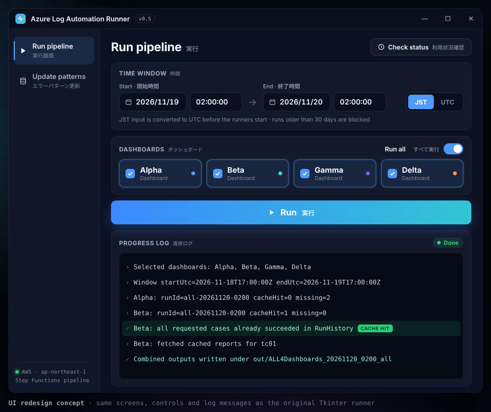
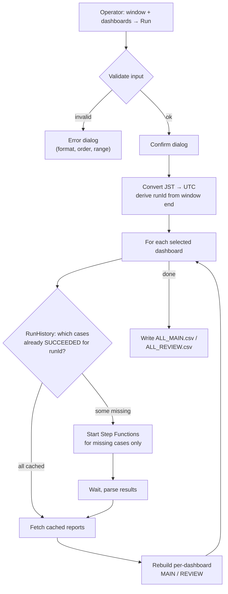
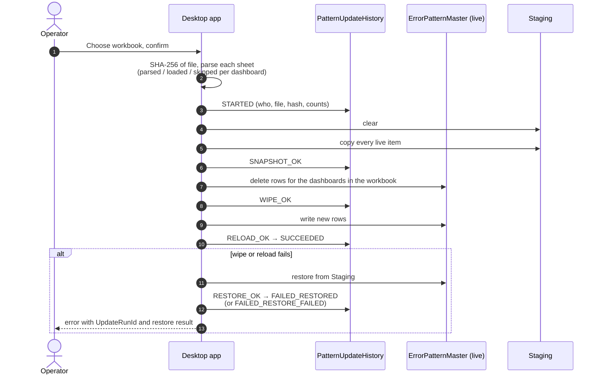

# Operator app

[← Back to README](../README.md)

Operators never touch AWS directly. A desktop app on their Windows workstation does two jobs: **run the pipeline** for a time window, and **update the error-pattern catalogue** from Excel.



<sub>A redesigned rendering of the app's run screen. The production app is a Tkinter window with the same screens, controls, labels and log messages.</sub>

## Screens

| Screen | Purpose |
|---|---|
| **Start** | Two actions: open the run screen, or update error patterns. |
| **Run pipeline** | Time window (start and end, JST or UTC), dashboard selection (any of the four, or *Run all*), **Run**, **Check status**, and a live progress log. |
| **Update patterns** | Pick the Excel workbook, confirm, and watch snapshot → wipe → reload in the same progress log. |

Long work runs on a background thread, and messages come back to the UI through a queue. The window stays responsive, and every control is disabled while a run is in progress.

## Running the pipeline



### Guard rails

| Check | Rule |
|---|---|
| Format | `YYYY/MM/DD HH:MM:SS`, 24-hour |
| Order | End must be after start |
| Look-back | Start may be at most **30 days** ago |
| Range | At most **7 days** in one run |
| Selection | At least one dashboard |
| Confirmation | Every run and every catalogue update asks for confirmation first |

### The run cache

The run ID is built from the window's end time, plus whether *Run all* was chosen or which dashboard. Running the same window again produces the same run ID. Before starting anything, the app does a `GetItem` on `RunHistory` for every case:

- **all cases `SUCCEEDED`**: nothing is executed. Reports are fetched straight from `Reports`.
- **some missing**: Step Functions runs only those cases, and the cached ones are fetched.
- **after a failure**: the next run picks up only the failed and unfinished cases.

A repeat request for the same morning's report costs a few DynamoDB reads instead of a full pipeline run.

### Check status

The pipeline runs in one shared AWS stack. **Check status** lists `RUNNING` executions of the state machine. If one exists, the app tells the operator that someone else is using the system and to try again in three minutes; otherwise it reports the system as available. Two operators can't unknowingly start overlapping runs.

### Output

```text
out/
├── <Dashboard>/individual/   per-case CSVs
├── <Dashboard>/final/        per-dashboard MAIN and REVIEW, in the team's report layout
└── ALL4Dashboards_<YYYYMMDD_HHMM>_<runId>/
    ├── ALL_MAIN.csv          Gamma → Alpha → Beta → Delta
    └── ALL_REVIEW.csv
```

A missing dashboard file is skipped; a header-only file contributes only its header. The final per-dashboard files are rebuilt locally from the case reports and the events. They can be regenerated without re-running AWS.

### Resolving the stack

The app finds table names and the state-machine ARN from the CloudFormation stack outputs. Where the direct CloudFormation lookup fails with an SSL error, a one-time script caches the outputs to a local file, and the app falls back to that file.

## Updating the error-pattern catalogue

Operators own the catalogue as an Excel workbook, one sheet per dashboard. The app turns that workbook into `ErrorPatternMaster` rows without anyone writing to DynamoDB by hand, and makes the change reversible.



**Why wipe and reload instead of diffing?** Catalogue edits rename, renumber and reorder rows. A wipe and reload scoped to the dashboard removes rows that no longer exist in the workbook, which a row-by-row diff misses, and leaves the other dashboards untouched.

**Why it's safe:**

- **Snapshot first.** Staging is cleared and refilled with an exact copy of the live table before anything is deleted. If the snapshot itself fails, the update stops before touching live data.
- **Automatic restore.** Any failure during wipe or reload restores the live table from staging, and the result is recorded.
- **Audit trail.** Every attempt records the Windows user, file name, file SHA-256, per-dashboard row counts, a timestamp for each step and the final status.
- **Immutable baseline.** `ErrorPatternMasterOriginal` holds the catalogue as first migrated. No update writes to it.
- **Plan-only mode.** The parser can run without AWS access to show what would be loaded and skipped per sheet.
- **Audit scripts.** For three of the four dashboards, a script compares the workbook's expected rows with the live table and reports missing rows, extra rows and over-broad URL prefixes.

### From spreadsheet to catalogue row

| Workbook column (meaning) | Catalogue attribute |
|---|---|
| Environment | `envName` |
| Status class | `codeClass` → part of the PK |
| Resource / component | `resourceName` (or `*`) |
| Operation name | `nameRaw`, and the method extracted into `methodOrStar` |
| URL(s) | `urlRawList`, and the normalized prefix in `urlPrefix` |
| Error codes | `errorCodesRaw` (explicit 4xx/5xx codes are extracted at match time) |
| Pattern number, disposition | `patternNo`, `patternDisposition` |

Rows the parser doesn't load, such as unsupported pattern types, are counted as **skipped** per sheet and shown in the log, never silently dropped.
